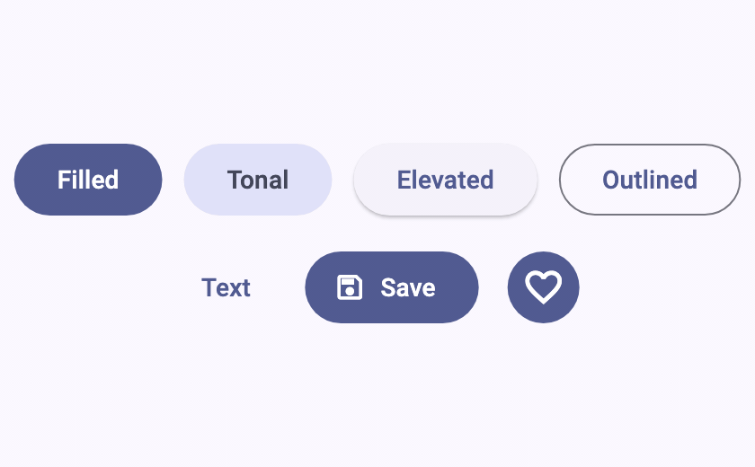
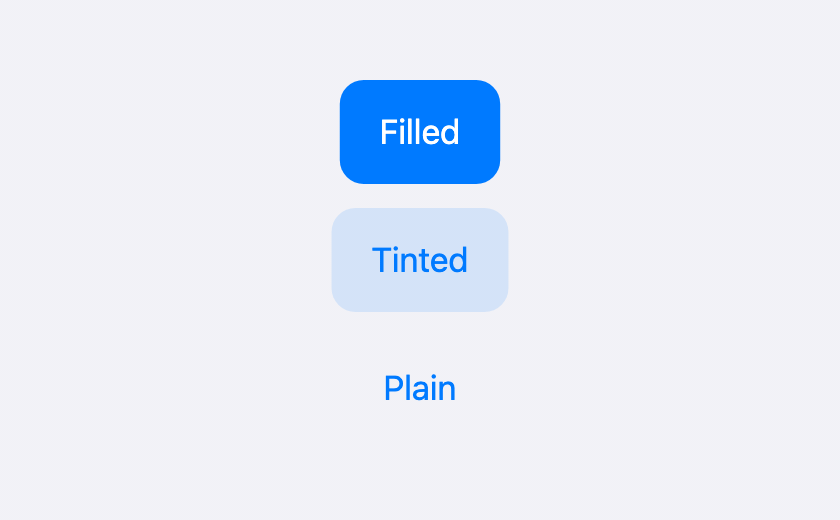
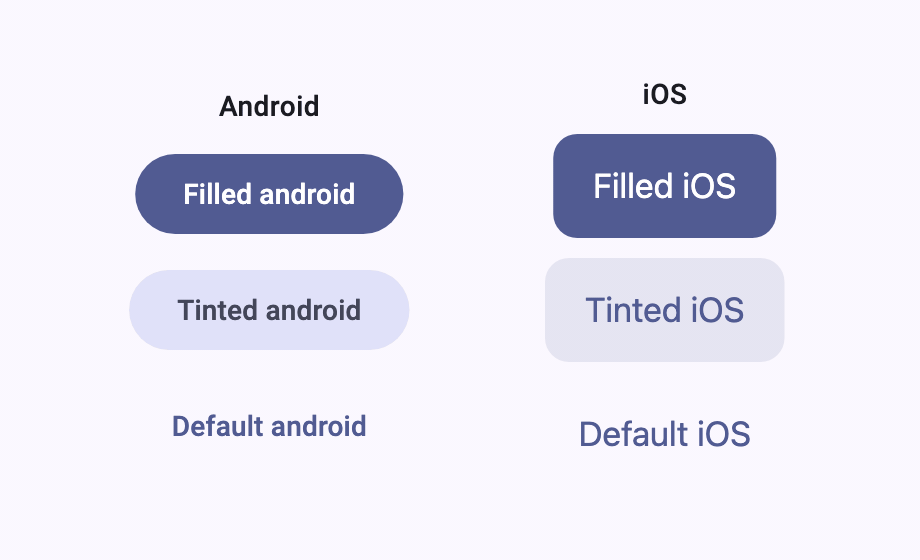
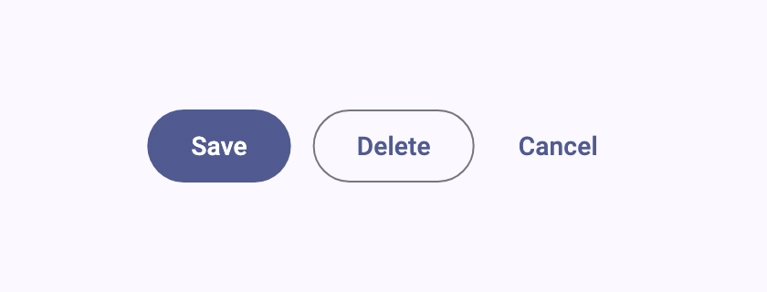

# loadable_buttons

Async loading for Flutter's own buttons. Each widget wraps the native
`material_ui` or `cupertino_ui` button, keeping its theme, sizing, and behavior,
and adds a loading state that blocks repeated taps while `onPressed` runs.

| Material | Cupertino |
| --- | --- |
|  |  |
| **Adaptive** | **Group** |
|  |  |

- Works with your existing `ThemeData`, `ButtonStyle`, and `CupertinoTheme`.
- Loading from your Future, from a `loading` flag, or from a controller.
- Adaptive buttons that render Material or Cupertino per platform.
- Groups that let only one related action run at a time.
- Accessible loading labels, custom loading content, and transitions.

## Installation

```sh
flutter pub add loadable_buttons material_ui
# Cupertino apps:
flutter pub add cupertino_ui
```

Requires Flutter 3.44+, Dart 3.12+, and the standalone
[`material_ui`](https://pub.dev/packages/material_ui) /
[`cupertino_ui`](https://pub.dev/packages/cupertino_ui) libraries. On Flutter
3.29 with the built-in Material library, use loadable_buttons 1.x; see the
[migration guide](doc/migration-v2.md).

## Quick start

Return your Future from `onPressed`. The button shows a spinner and ignores taps
until it completes:

```dart
import 'package:loadable_buttons/loadable_buttons.dart';
import 'package:material_ui/material_ui.dart';

AsyncFilledButton(
  onPressed: saveChanges, // Future<void> Function()
  loadingSemanticsLabel: 'Saving',
  child: const Text('Save'),
);
```

Cupertino works the same way, with no Material ancestor:

```dart
import 'package:cupertino_ui/cupertino_ui.dart';
import 'package:loadable_buttons/cupertino.dart';

AsyncCupertinoButton.filled(
  onPressed: saveChanges,
  child: const Text('Save'),
);
```

Import `material.dart` or `cupertino.dart` for one design system, or
`loadable_buttons.dart` for both and the adaptive button.

## Buttons

| Widget | Constructors |
| --- | --- |
| `AsyncElevatedButton` | default, `.icon` |
| `AsyncFilledButton` | default, `.icon`, `.tonal`, `.tonalIcon` |
| `AsyncOutlinedButton` | default, `.icon` |
| `AsyncTextButton` | default, `.icon` |
| `AsyncIconButton` | default, `.filled`, `.filledTonal`, `.outlined` |
| `AsyncFloatingActionButton` | default, `.small`, `.large`, `.extended` |
| `AsyncCupertinoButton` | default, `.filled`, `.tinted` |
| `AsyncAdaptiveButton` | default, `.filled`, `.tinted` |

Each accepts its native widget's options, such as `style`, `focusNode`,
`tooltip`, or `sizeStyle`. Elevated, Filled, Outlined, and Text buttons also
take shortcuts like `padding`, `minimumSize`, and enabled or disabled colors,
which take precedence over `style` and the theme. See the
[API reference](https://pub.dev/documentation/loadable_buttons/latest/) for every
option.

### Adaptive buttons

`AsyncAdaptiveButton` renders Cupertino on iOS and macOS and Material
elsewhere, following `Theme.of(context).platform` or its `platform` parameter:

| Constructor | Material | Cupertino |
| --- | --- | --- |
| default | `AsyncTextButton` | `AsyncCupertinoButton` |
| `.filled` | `AsyncFilledButton` | `AsyncCupertinoButton.filled` |
| `.tinted` | `AsyncFilledButton.tonal` | `AsyncCupertinoButton.tinted` |

Shared options such as `padding` and colors apply to both. `materialStyle` and
`cupertinoSizeStyle` apply to one. If the platform changes mid-operation, the
new button stays loading until the work finishes.

## Loading

A button is loading while any of these is active:

- **Its own operation:** the Future returned by `onPressed`, and `onError` if
  one is supplied.
- **The `loading` flag:** for work your app already tracks.

  ```dart
  AsyncElevatedButton(
    loading: isSaving,
    onPressed: saveChanges,
    child: const Text('Save'),
  );
  ```

- **A controller's `loading` request:** see below.

Clearing `loading` never unlocks an operation that is still running.

### Controllers

An `AsyncButtonController` lets other widgets watch a button's work or request
loading. You create and dispose it:

```dart
final saveController = AsyncButtonController();

AsyncFilledButton(
  controller: saveController,
  onPressed: saveChanges,
  child: const Text('Save'),
);

ListenableBuilder(
  listenable: saveController,
  builder: (context, _) => TextButton(
    onPressed: saveController.isPending ? null : cancel,
    child: const Text('Cancel'),
  ),
);
```

`isPending` is true while the operation runs, `loading` is a manual request,
and `isLoading` combines both. Use one controller per button.

### Groups

Wrap related buttons in an `AsyncButtonGroup` so only one runs at a time. The
active button shows loading; the others are disabled without a spinner.
`excludeFromGroup` keeps escape actions available:

```dart
AsyncButtonGroup(
  child: Row(
    children: [
      AsyncFilledButton(onPressed: save, child: const Text('Save')),
      AsyncOutlinedButton(onPressed: delete, child: const Text('Delete')),
      AsyncTextButton(
        excludeFromGroup: true,
        onPressed: cancel,
        child: const Text('Cancel'),
      ),
    ],
  ),
);
```

Use `AsyncButtonGroup.isActiveOf(context)` to disable other widgets while a
member runs. The group never cancels work; give long operations a timeout.

### Errors

Without `onError`, errors propagate with their original stack trace. With it,
the handler consumes the error, and the button stays loading until the handler
finishes:

```dart
AsyncElevatedButton(
  onPressed: saveChanges,
  onError: (error, stackTrace) => showSaveFailed(error),
  child: const Text('Save'),
);
```

Handlers may run after the widget is disposed, so check `mounted` before using
state or context. See the [error policy](doc/callback-error-policy.md).

## Customization

Replace the spinner with `loadingChild` and pick a transition:

```dart
AsyncOutlinedButton(
  onPressed: saveChanges,
  loadingChild: const Text('Saving…'),
  transitionType: TransitionAnimationType.animatedSwitcher,
  child: const Text('Save'),
);
```

| `transitionType` | Behavior |
| --- | --- |
| `stack` (default) | Fades loading content over the idle content, keeping its size. |
| `animatedSwitcher` | Cross-fades between idle and loading content. |
| `customBuilder` | Calls your `customBuilder(loading, child, loadingChild)`. |

### Accessibility

Set `loadingSemanticsLabel` to a localized label for the default spinner; the
package ships no English text. Custom `loadingChild` content owns its own
labels. Loading buttons report as disabled, and hidden content can't be focused
or activated. See the [semantics policy](doc/loading-semantics-policy.md).

### DevTools

The Flutter inspector shows each button's options and its runtime state:
loading, a pending operation, or blocked by a group.

## AI agent skill

The package ships a `loadable-buttons-usage` skill that teaches coding agents
its APIs and contracts. Install it from your app's root with the
[skills CLI](https://pub.dev/packages/skills), choosing your `--agent`:

```sh
dart run skills@ get --package loadable_buttons --agent claude
```

## FAQ

<details>
<summary>Do I need a controller or a state management package?</summary>

No. Return your Future from `onPressed` and the button manages its loading
state. Add `loading`, a controller, or a group only when you need them.

</details>

<details>
<summary>Can I copy a button into my project?</summary>

Yes. The code is [MIT licensed](LICENSE); keep the license notice with copied
code. Copy the button's file and any `part` files, plus
`async_button_helpers.dart` and `loading_transition.dart`. Material buttons also
need `async_material_button_helpers.dart`, and `async_adaptive_button.dart`
needs the Text, Filled, and Cupertino button files it renders. Update package
imports to match your project. Keep the inactive-content guards from
`loading_transition.dart` if you inline it.

</details>

## More

- [Migration from 1.x](doc/migration-v2.md)
- [Example app](https://github.com/hectorAguero/loadable_buttons/tree/main/example)
- [Changelog](CHANGELOG.md)
- [Contributing](https://github.com/hectorAguero/loadable_buttons/blob/main/CONTRIBUTING.md)
- [Issues](https://github.com/hectorAguero/loadable_buttons/issues)
